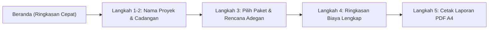

# Buku Panduan Lengkap: Instalasi (Windows & Mac) dan Cara Penggunaan Aplikasi
**AI Video Budget Calculator — Versi Terbaru (`v1.7.0`)**

Selamat datang di panduan lengkap **AI Video Budget Calculator**!
Dokumen ini disusun khusus dengan bahasa sehari-hari yang mudah diikuti (tanpa istilah pemrograman yang rumit) agar Anda dapat:
1. Menginstal dan menjalankan aplikasi di **Windows** maupun **Mac (macOS)** langkah demi langkah.
2. Menggunakan seluruh fitur aplikasi sesuai **model perhitungan dan tampilan terbaru**.

---

## BAGIAN 1: Panduan Instalasi di Windows (Step-by-Step)

Di komputer **Windows**, semua cara instalasi dan penggunaan yang sudah ada tetap dipertahankan sepenuhnya. Anda memiliki **3 pilihan cara** sesuai kebutuhan:

### Pilihan A: Langsung Pakai Tanpa Install (*Zero-Install* — Paling Cepat untuk Coba-Coba)
Gunakan cara ini jika Anda ingin langsung membuka aplikasi tanpa memasangnya ke dalam sistem Windows:
1. Buka folder proyek **Desktop Token Calculator app** di File Explorer Windows Anda.
2. Cari file bernama **`Klik-Untuk-Testing-Tanpa-Install.bat`**.
3. **Klik 2x (Double Click)** file tersebut.
4. Jendela hitam kecil akan muncul sebentar untuk menyiapkan layar, lalu aplikasi **AI Video Budget Calculator** akan langsung terbuka dan siap digunakan!

### Pilihan B: Membuat File Installer Windows (`.exe` Setup & Portable)
Gunakan cara ini jika Anda ingin menghasilkan file installer `.exe` yang bisa dipasang permanen di Desktop/Start Menu Windows atau dibagikan ke komputer Windows lain:
1. Buka folder proyek, lalu **Klik 2x** file **`Buat-Publish-Installer.bat`**.
2. Tunggu sekitar 1–2 menit hingga muncul tulisan **"Selesai! File aplikasi siap pakai tersedia di dalam folder release\"**.
3. Buka folder **`release`** yang baru muncul di dalam folder proyek Anda. Di dalamnya tersedia 2 jenis file:
   - **`AI Video Budget Calculator-1.7.0-portable.exe` (Versi Portable)**:
     - Tidak perlu diinstal. Cukup klik 2x file ini dari mana saja (termasuk dari flashdisk), aplikasi langsung menyala.
   - **`AI Video Budget Calculator-1.7.0-nsis.exe` (Versi Installer Standar)**:
     - Klik 2x file ini $\rightarrow$ pilih lokasi folder instalasi $\rightarrow$ klik **Install**.
     - Setelah selesai, ikon **AI Video Budget Calculator** akan otomatis muncul di layar **Desktop** dan **Start Menu Windows** Anda.

---

## BAGIAN 2: Panduan Instalasi di Mac / macOS (Step-by-Step)

Di komputer **Mac** (baik MacBook/iMac dengan chip **Apple Silicon M1/M2/M3/M4** maupun **Mac Intel**), kami telah menyediakan **tombol perintah 1-Klik (`.command`)** yang cara kerjanya semudah file `.bat` di Windows!

### Persiapan Awal (Hanya Sekali di Mac)
1. Salin satu folder proyek **Desktop Token Calculator app** ini ke dalam komputer Mac Anda (misalnya ke folder `Downloads` atau `Documents`).
2. Pastikan komputer Mac Anda sudah memiliki **Node.js** (jika belum ada, unduh gratis versi **LTS** untuk macOS di [https://nodejs.org](https://nodejs.org) lalu klik *Next* sampai selesai).
3. **Tips Penting Pertama Kali di Mac (Izin Klik 2x)**:
   - Jika folder disalin lewat *Flashdisk* atau *Google Drive*, terkadang Mac mengunci izin klik 2x pada file `.command`.
   - Untuk membukanya sekali saja: buka aplikasi **Terminal** di Mac, ketik `cd ` (diikuti spasi), tarik (*drag & drop*) folder proyek ini ke dalam Terminal lalu tekan **Enter**, kemudian ketik perintah berikut lalu tekan **Enter**:
     ```bash
     chmod +x *.command
     ```

---

### Pilihan A (Rekomendasi): Instalasi 1-Klik Langsung Masuk ke Applications / Launchpad Mac
Cara paling praktis agar aplikasi langsung terpasang di folder **Applications** Mac Anda tanpa perlu geser-geser file manual:
1. Buka folder proyek di **Finder** Mac Anda.
2. Cari file bernama **`Install-Langsung-Ke-Mac.command`**.
3. **Klik 2x (Double Click)** file tersebut.
   *(Catatan: Jika Mac memunculkan pesan keamanan saat pertama kali diklik, cukup **Klik Kanan** pada file `Install-Langsung-Ke-Mac.command` $\rightarrow$ pilih **Open** $\rightarrow$ klik **Open**).*
4. Tunggu proses otomatis berjalan (sekitar 1–2 menit pada penggunaan pertama karena Mac sedang menyiapkan mesin khusus macOS):
   - Tahap `[1/3]`: Menyiapkan komponen aplikasi khusus untuk macOS.
   - Tahap `[2/3]`: Membungkus aplikasi menjadi `AI Video Budget Calculator.app`.
   - Tahap `[3/3]`: Memasang aplikasi langsung ke folder **`/Applications`** di Mac Anda dan membuka kunci keamanan Apple (*Gatekeeper*) secara otomatis.
5. Begitu selesai, aplikasi akan **langsung terbuka otomatis**! Selanjutnya, Anda bisa membukanya kapan saja langsung dari **Launchpad**, **Spotlight Search (`Cmd + Space`)**, atau folder **Applications** di Mac Anda.

---

### Pilihan B: Membuat File Installer `.DMG` & `.ZIP` untuk Mac (Untuk Dibagikan ke Mac Lain)
Gunakan cara ini jika Anda ingin membuat file installer standar Mac (`.dmg` atau `.zip`) yang bisa dikirimkan ke rekan kerja atau klien pengguna Mac lainnya:
1. Di Finder Mac Anda, **Klik 2x** file **`Buat-Publish-Installer-Mac.command`** (atau **Klik Kanan $\rightarrow$ Open**).
2. Tunggu hingga proses pembungkusan selesai. Setelah selesai, folder **`release`** akan otomatis terbuka di Finder Mac Anda!
3. Di dalam folder **`release/`**, Anda akan mendapatkan file:
   - **`AI Video Budget Calculator-1.7.0-mac-arm64.dmg`** (atau `-x64.dmg` untuk Mac Intel).
   - **`AI Video Budget Calculator-1.7.0-mac-arm64.zip`**.
4. **Cara Menginstal File `.dmg` di Mac Mana Saja**:
   - **Langkah 1**: Klik 2x file **`.dmg`** tersebut hingga muncul jendela instalasi.
   - **Langkah 2**: Tarik (*drag & drop*) ikon **AI Video Budget Calculator** ke dalam folder **Applications**.
   - **Langkah 3**: Buka folder **Applications**, lalu **Klik Kanan** pada **AI Video Budget Calculator** $\rightarrow$ pilih **Open** $\rightarrow$ klik **Open** (langkah *Klik Kanan $\rightarrow$ Open* ini hanya perlu dilakukan 1 kali saat pertama kali membuka aplikasi baru di Mac).

---

### Pilihan C: Langsung Buka Tanpa Install di Mac (*Zero-Install*)
Jika Anda hanya ingin membuka aplikasinya di Mac tanpa memasangnya ke folder Applications:
1. Di Finder Mac Anda, **Klik 2x** file **`Klik-Untuk-Testing-Tanpa-Install-Mac.command`** (atau **Klik Kanan $\rightarrow$ Open**).
2. Aplikasi akan langsung menyala di layar Mac Anda!

---

## BAGIAN 3: Panduan Penggunaan Aplikasi (Sesuai Versi Terbaru `v1.7.0`)

Bayangkan aplikasi ini seperti **Asisten Kasir & Perencana Produksi Studio Video AI**.
Anda cukup mengikuti **alur berurutan dari Langkah 1 sampai Langkah 5** di menu sebelah kiri (atau tombol langkah di bagian bawah layar).



---

### 1. Mengenal Tampilan Utama & Menu Kiri (*Sidebar*)
Saat aplikasi terbuka, perhatikan menu navigasi di sebelah kiri layar:
- **Buka / Tutup Menu Kiri (*Minimize Sidebar*)**:
  - Klik **tombol panah (`<` / `>`)** di pojok kanan atas menu kiri (atau tekan tombol pintas keyboard **`Ctrl + B`** di Windows / **`Cmd + B`** di Mac) untuk mengecilkan menu kiri menjadi deretan ikon minimalis agar area kerja lebih lega.
- **Tombol Aksi di Kiri Bawah (Selalu Terlihat Tanpa Perlu Scroll)**:
  - **Simpan Proyek**: Menyimpan pekerjaan Anda ke dalam file proyek (`.aivbudget`) di komputer.
  - **Buka Proyek**: Membuka kembali file `.aivbudget` yang pernah Anda simpan sebelumnya.
  - **Proyek Baru**: Memulai hitungan baru dari awal.
- **Tombol Pengaturan di Pojok Kanan Atas Layar**:
  - **Intip Anggaran**: Melihat posisi total biaya & rumus kali buat dari halaman mana saja lewat jendela *popup* kaca buram (*Frosted Glass*).
  - **Panduan**: Membuka rangkuman cara pakai 4 langkah.
  - **Bahasa (`ID` / `EN`)**: Mengganti bahasa tampilan antara **Bahasa Indonesia** dan **Bahasa Inggris**.
  - **Mode Gelap / Terang**: Mengganti tema warna layar antara **Mode Gelap (*Dark Mode*)** dan **Mode Terang (*White Mode*)** yang sudah dioptimalkan kontras warnanya agar nyaman di mata.

---

### 2. Halaman Beranda (*Dashboard*)
Halaman **Beranda** adalah pusat kendali untuk melihat gambaran besar anggaran proyek Anda dalam satu pandangan:
1. **Kartu Utama Estimasi Total Anggaran**:
   - Menampilkan total anggaran dalam **Rupiah (IDR)** dan **Dolar AS (USD)** beserta total **Credits Higgsfield** yang dibutuhkan.
   - Menampilkan lencana rumus terbaru: **`Total Kebutuhan × Cadangan Langkah 2 = Total Kali Buat AI`** (contoh: `25 adegan × 2 cadangan = 50 kali buat`).
2. **3 Kartu Metrik Pendukung di Bawahnya**:
   - **Kartu 1 (Rincian Kali Buat AI)**: Memperlihatkan jumlah adegan/aset yang direncanakan dikalikan dengan cadangan per adegan dari Langkah 2.
   - **Kartu 2 (Rata-rata Biaya per Video & Menit)**: Menampilkan berapa biaya rata-rata untuk menghasilkan **1 video jadi** dan biaya per **1 menit durasi video**.
   - **Kartu 3 (Paket Higgsfield & Status Data)**: Menampilkan paket langganan Higgsfield yang sedang aktif (beserta harga per 1 Credit) dan apakah seluruh harga model AI sudah lengkap.
3. **Tombol Contoh Proyek Siap Pakai**:
   - Klik **"Muat Contoh Proyek Iklan"** jika Anda ingin melihat contoh simulasi produksi iklan lengkap (7 tahapan dari pembuatan gambar karakter, animasi video, hingga peningkatan kualitas 4K).

---

### 3. Langkah 1–2: Pengaturan Proyek & Cadangan
Di halaman ini Anda menentukan identitas proyek dan faktor pengali cadangan:
1. **Langkah 1 — Informasi Dasar Proyek**:
   - **Nama Proyek**: Ketik nama proyek video Anda (misal: *Iklan Peluncuran Produk Kopi*).
   - **Jumlah Video Jadi**: Berapa video utuh yang ingin dihasilkan di akhir proyek (misal: `2` video).
   - **Total Durasi Semua Video (Menit)**: Total panjang durasi seluruh video jadi jika digabung (misal: `1.5` menit).
   - **Cara Menghitung Kebutuhan Adegan**:
     - Pilih **"Hitung per Tahapan Adegan (Disarankan)"** jika Anda ingin mengisi jumlah adegan secara bebas di tiap baris pekerjaan.
     - Pilih **"Kalikan Otomatis dengan Jumlah Video"** jika Anda membuat beberapa video dengan struktur adegan yang seragam.
2. **Langkah 2 — Berapa Kali Cadangan per Adegan?**:
   - Dalam pembuatan video AI, terkadang hasil pertama belum langsung pas sehingga perlu dibuat ulang (*re-roll*).
   - Pilih tombol cepat **`1x (Tanpa Cadangan)`**, **`2x Cadangan (Disarankan)`**, **`3x Cadangan`**, **`5x Cadangan`**, atau ketik angkanya sendiri.
   - **Cara Kerjanya**: Angka cadangan yang Anda pilih di sini akan **otomatis mengalikan seluruh tahapan adegan di Langkah 3**.
     - *Contoh*: Jika total kebutuhan Anda `25 adegan` dan Anda memilih cadangan `2x`, maka total pembuatan AI menjadi **`25 × 2 = 50 kali buat`**.

---

### 4. Langkah 3: Rencana Adegan (*Production Planner*)
Di halaman ini Anda menyusun daftar tahapan pembuatan gambar dan video AI:
1. **Pilih Paket Langganan Higgsfield di Bagian Atas**:
   - Anda bisa langsung memilih paket **Basic ($9/bln)**, **Pro ($19/bln)**, **Ultimate ($39/bln)**, **Creator ($149/bln)**, atau **Standar / Eceran**.
   - Begitu paket dipilih, harga Dolar dan Rupiah di seluruh adegan akan otomatis menyesuaikan dengan tarif per Credit paket tersebut!
2. **Tambah Tahapan Produksi**:
   - Klik **"Tambah Tahapan"** untuk menambah 1 baris pekerjaan baru, atau klik **"Isi Paket Tahapan"** untuk memasukkan paket tahapan produksi otomatis (Paket Hemat, Paket Lengkap, atau Paket Kualitas 4K).
3. **Atur Detail Adegan lewat Jendela Popup**:
   - Pada baris tahapan mana pun, klik tombol **"Atur Adegan"**.
   - Di dalam jendela *popup* yang rapi, Anda bisa mengatur:
     1. **Nama Tahapan** (misal: *Adegan Pembuka Drone*).
     2. **Jenis Pekerjaan AI** (7 kategori: *Teks ke Gambar*, *Gambar ke Gambar*, *Gambar ke Video*, *Teks ke Video*, *Video ke Video*, *Perjelas Gambar*, atau *Perjelas Video 4K*).
     3. **Model AI & Variasi Kualitas** (misal: *SOUL V2*, *Kling 3.0*, *Seedance 2.5*, *Wan 2.2*, *Veo 3.1*, *Sora 2*, dll.).
     4. **Jumlah Adegan/Gambar yang Dibutuhkan** serta **Durasi per Video (Detik)**.
     5. **Centang Paket Unlimited (Rp 0)**: Jika model tersebut gratis tanpa batas di paket langganan Anda, centang pilihan ini agar biayanya dihitung **Rp 0 (0 Credit)**.

---

### 5. Langkah 4: Ringkasan Biaya (*Budget Summary*)
Halaman ini menampilkan hasil perhitungan akhir dengan tata letak yang bersih dan mudah dipahami:
1. **Kartu Utama Total Biaya Keseluruhan**:
   - Menampilkan total anggaran akhir dalam **Rupiah** dan **USD**, lengkap dengan rincian rumus **`Kebutuhan × Cadangan = Total Kali Buat`** dan total **Credits**.
2. **3 Kartu Ringkasan Utama**:
   - **Kartu 1 (Total Rencana Produksi)**: Menunjukkan angka **Kebutuhan Adegan** dikali **Cadangan per Adegan** = **Total Kali Buat**.
   - **Kartu 2 (Biaya per 1 Video Jadi)**: Membagi total biaya keseluruhan dengan jumlah target video jadi Anda.
   - **Kartu 3 (Biaya per 1 Menit Video)**: Membagi total biaya keseluruhan dengan total durasi menit video Anda.
3. **Jendela Popup Rincian Lengkap**:
   - Klik **"Rincian Rumus & Biaya"** untuk melihat penjabaran matematika dari awal sampai akhir.
   - Klik **"Tabel Rincian per Tahapan"** untuk melihat tabel biaya per baris adegan dan per kategori proses AI.

---

### 6. Halaman Katalog & Kurs (*Data & Settings*)
Halaman ini digunakan jika Anda ingin mengatur nilai tukar mata uang atau daftar model AI:
1. **Pilih Paket Credit Higgsfield**: Pilih paket langganan atau ketik harga kustom per 1 Credit.
2. **Kurs Dolar ke Rupiah (USD $\rightarrow$ IDR)**:
   - Klik tombol **"Perbarui Kurs Otomatis"** untuk mengambil kurs terbaru dari internet.
   - Atau ketik angka kurs sendiri di kotak **Kurs Manual** (misal: `16500`) jika Anda menggunakan kurs tetap perusahaan/klien.
3. **Katalog Model AI**: Anda dapat melihat seluruh daftar model resmi Higgsfield, mengubah harganya, atau menambahkan model AI baru milik Anda sendiri lewat tombol **"Tambah Model Baru"**.

---

### 7. Langkah 5: Cetak Laporan PDF (*Export PDF*)
Setelah anggaran selesai dihitung, Anda dapat mencetaknya menjadi dokumen resmi ukuran A4:
1. Isi **Judul Laporan**, **Tanggal**, **Disusun Oleh**, dan **Untuk Klien / Tim**.
2. Centang bagian-bagian laporan yang ingin ditampilkan (Ringkasan Eksekutif, Rincian Tahapan, Rincian Credit, Info Kurs, dll.).
3. Lihat tampilan kertas laporan secara langsung di sebelah kanan layar (**Pratinjau Kertas A4**).
4. Klik tombol biru **"Simpan sebagai PDF"** di bagian atas untuk menyimpan file `.pdf` ke komputer Windows atau Mac Anda!
