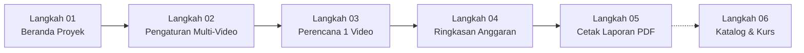

# Buku Panduan Lengkap: Instalasi (Windows & Mac) dan Cara Penggunaan Aplikasi
**AI Video Budget Calculator — Versi 2.1.3 (Studio Edition)**

Selamat datang di **Buku Panduan Lengkap AI Video Budget Calculator (Versi 2.1.3 - Studio Edition)**!
Dokumen ini disusun khusus dengan bahasa sehari-hari yang ramah pemula (tanpa istilah teknis yang membingungkan) agar Anda dapat:
1. Memahami cara kerja aplikasi menggunakan analogi dunia nyata yang sederhana.
2. Menginstal dan menjalankan aplikasi di komputer **Windows** maupun **Mac (macOS)** dengan mudah.
3. Menggunakan seluruh fitur terbaru: **Multi-Video Workflow**, **Kalkulator Durasi Bersih**, **Voice Over Resmi ElevenLabs**, serta **Musik Pengiring Resmi Suno AI & Pemisahan Stems**.

---

## Memahami Cara Kerja Aplikasi Lewat Analogi Sederhana

Bayangkan aplikasi ini seperti **Meja Kasir & Manajer Produksi Studio Film AI**:
1. **Tampilan Layar (*Frontend*)**: Seperti ruang kerja studio modern berlapis kaca (*Apple Glassmorphism*) tempat Anda mengetik kebutuhan, memilih model AI, dan melihat angka biaya secara langsung.
2. **Mesin Hitung Presisi (*Backend / Math Engine*)**: Seperti tim kalkulator akuntansi profesional di balik layar yang menghitung biaya menggunakan ketelitian 28 digit desimal (`Decimal.js`), memastikan tidak ada selisih pembulatan satu Rupiah pun.
3. **Penyimpanan Berkas Proyek (*Database / File .aivbudget*)**: Seperti lemari berkas aman. Setiap proyek disimpan dalam berkas kecil berekstensi `.aivbudget` yang bisa disimpan, dibuka kembali, atau dibagikan ke rekan kerja kapan saja tanpa merusak data lama.
4. **3 Penyedia Jasa AI Terpadu (*3 Providers*)**:
   - **🎬 Higgsfield**: Pabrik gambar dan video (mengubah teks jadi gambar, gambar jadi video, transformasi video, dan peningkatan resolusi 4K).
   - **🎙️ ElevenLabs**: Studio rekaman sulih suara profesional (mengubah karakter naskah menjadi suara manusia alami dalam bahasa Indonesia atau Inggris).
   - **🎵 Suno AI**: Studio rekaman musik & komposer latar film (menghasilkan 2 variasi musik setiap pembuatan, lengkap dengan pemisahan track drum/vokal/instrumen).

---

## BAGIAN 1: Panduan Instalasi di Komputer Windows (Step-by-Step)

Di komputer **Windows**, Anda memiliki **3 pilihan cara praktis** sesuai kebutuhan:

### Pilihan A: Langsung Pakai Tanpa Install (*Zero-Install* — Paling Cepat untuk Coba-Coba)
Gunakan cara ini jika Anda ingin langsung membuka aplikasi tanpa memasangnya ke dalam sistem Windows:
1. Buka folder proyek **Desktop Token Calculator app** di File Explorer Windows Anda.
2. Cari file bernama **`Klik-Untuk-Testing-Tanpa-Install.bat`**.
3. **Klik 2x (Double Click)** file tersebut.
4. Jendela persiapan kecil akan muncul sebentar, lalu aplikasi **AI Video Budget Calculator Versi 2.1.3** akan langsung terbuka dan siap digunakan!

### Pilihan B: Menggunakan File Portable (*Zero-Install Mandiri*)
1. Klik 2x file **`Buat-Publish-Installer.bat`**.
2. Buka folder **`release/`** yang muncul di dalam folder proyek.
3. Cari file **`AI Video Budget Calculator-2.1.3-portable.exe`**.
4. File ini bisa Anda simpan di Flashdisk atau folder mana saja. Cukup klik 2x, aplikasi langsung jalan tanpa instalasi.

### Pilihan C: Memasang Permanen di Windows (*Installer Standar .exe*)
1. Dari folder **`release/`**, klik 2x file **`AI Video Budget Calculator-2.1.3-nsis.exe`**.
2. Pilih lokasi folder instalasi lalu klik **Install**.
3. Setelah selesai, ikon aplikasi akan otomatis muncul di layar **Desktop** dan menu **Start Windows** Anda.

---

## BAGIAN 2: Panduan Instalasi di Mac / macOS (Step-by-Step)

Di komputer **Mac** (baik MacBook/iMac dengan chip **Apple Silicon M1/M2/M3/M4** maupun **Mac Intel**), kami menyediakan tombol perintah 1-Klik (`.command`):

### Persiapan Awal di Mac (Hanya 1 Kali)
1. Salin folder proyek ini ke dalam komputer Mac Anda (misal ke folder `Downloads` atau `Documents`).
2. Pastikan komputer Mac memiliki **Node.js LTS** dari [https://nodejs.org](https://nodejs.org).
3. **Jika file `.command` terkunci saat pertama kali disalin dari flashdisk**:
   - Buka aplikasi **Terminal** di Mac.
   - Ketik `cd ` (diikuti spasi), tarik folder proyek ke dalam Terminal, tekan **Enter**.
   - Ketik `chmod +x *.command` lalu tekan **Enter**.

### Pilihan A (Rekomendasi): Pasang 1-Klik Langsung ke Folder Applications Mac
1. Buka folder proyek di **Finder** Mac Anda.
2. **Klik 2x** file **`Install-Langsung-Ke-Mac.command`** (atau Klik Kanan $\rightarrow$ Open saat pertama kali).
3. Script otomatis menyiapkan aplikasi, memasangnya ke folder **`/Applications`** (Launchpad), membuka kunci keamanan Apple (*Gatekeeper*), dan langsung menyalakan aplikasinya.

### Pilihan B: Membuat File Installer `.DMG` & `.ZIP` untuk Mac
1. Klik 2x file **`Buat-Publish-Installer-Mac.command`**.
2. Folder **`release/`** akan terbuka berisi file **`.dmg`** dan **`.zip`** siap dibagikan ke komputer Mac mana saja.

### Pilihan C: Buka Langsung Tanpa Install di Mac (*Zero-Install*)
1. Klik 2x file **`Klik-Untuk-Testing-Tanpa-Install-Mac.command`**.

---

## BAGIAN 3: Panduan Lengkap 6 Langkah Alur Kerja Versi 2.1.3

Aplikasi dirancang dengan **alur kerja 6 langkah terpadu** yang saling terhubung:

---

### Langkah 01: Beranda Proyek (*Dashboard*)
Pusat kendali studio untuk melihat ikhtisar anggaran proyek:
- **Kartu Utama Hero Anggaran**: Menampilkan Grand Total Anggaran dalam **Rupiah (IDR)**, **Dolar (USD)**, serta konsumsi kredit dari 3 platform: **Higgsfield**, **ElevenLabs**, dan **Suno AI**.
- **Tombol Contoh Siap Pakai**: Klik *"Coba Contoh Proyek Iklan Lengkap"* untuk memuat simulasi produksi studio komersial lengkap.
- **Bilah Samping Kiri (*Sidebar*)**: Bisa dibuka-tutup dengan tombol panah atau tombol keyboard **`Ctrl + B`** (Windows) / **`Cmd + B`** (Mac). Dilengkapi tombol cepat Simpan Proyek, Buka Proyek, dan Intip Anggaran di kiri bawah.

---

### Langkah 02: Pengaturan & Cadangan Proyek (Multi-Video Setup)
Di tahap ini Anda menentukan skala produksi proyek:
1. **Nama Proyek**: Beri nama proyek Anda (misal: *Serial Konten Edukasi AI 2026*).
2. **Target Jumlah Video Jadi (Multi-Video)**:
   - Pilih tombol cepat **1 Video**, **3 Video**, **5 Video**, **10 Video**, atau ketik angka sendiri.
   - *Prinsip Multi-Video*: Anda hanya perlu merancang kebutuhan adegan untuk **1 video utuh** di Langkah 3. Mesin kalkulator akan otomatis mengalikan total anggaran dengan jumlah video di Langkah 2 ini.
3. **Berapa Kali Cadangan Coba-Coba (*Re-roll Reserve*)**:
   - Dalam dunia AI, hasil pembuatan pertama terkadang belum sempurna.
   - Pilih **1x (Tanpa Cadangan)**, **2x Cadangan (Standar Disarankan)**, **3x**, **5x**, atau persentase manual.
4. **Target Durasi Bersih Video (Post-Produksi)**:
   - Tentukan target panjang video hasil akhir editing Anda (misal: 1 Menit = 60 detik).

---

### Langkah 03: Daftar Pekerjaan AI (*Production Planner*)
Di tahap ini Anda merancang kebutuhan pembuatan aset AI untuk **1 video utuh**:
1. **Lencana Status Atas Layar**: Menampilkan informasi *"Menyusun Kebutuhan untuk 1 Video"* dan *"⏱️ Panjang 1 Video (Durasi Bersih): X Detik"*.
2. **4 Kategori Pekerjaan AI**:
   - **🎬 Video & Animasi (Higgsfield)**: *Text-to-Video*, *Image-to-Video*, *Video-to-Video*, dan *Upscale Video 4K*.
   - **🖼️ Gambar Visual (Higgsfield)**: *Text-to-Image*, *Image-to-Image*, dan *Upscale Image*.
   - **🎙️ Voice Over & Pengisi Suara (ElevenLabs)**:
     - Pilih model resmi: *Eleven Multilingual v2*, *Eleven Flash v2.5*, atau *Eleven Turbo v2.5*.
     - Cukup masukkan jumlah karakter naskah suara (atau ketik naskah jika ingin dihitung otomatis).
   - **🎵 Musik & Soundtrack (Suno AI)**:
     - Pilih model resmi: *Suno v6 (Flagship Studio)*, *v6-wild*, *v6-mini*, *v4*, *v3.5*, atau *v3*.
     - Tentukan target durasi musik (dilengkapi tombol *"Samakan dgn Durasi Video"*).
     - Atur jumlah lagu dan jumlah percobaan generate (1 generate = 10 kredit menghasilkan 2 variasi lagu).
     - **Pemisahan Track Audio (Stems)**: Aktifkan jika butuh memisahkan vokal dan instrumen (*2-Stems Split* +20 Cr atau *Full Studio Stems* +50 Cr).

---

### Langkah 04: Ringkasan Biaya Lengkap (*Budget Summary*)
Di tahap ini Anda melihat rincian matematika anggaran yang transparan:
1. **Komparasi Multi-Video**: Menampilkan perbandingan biaya murni untuk **1 Video** bersanding dengan **Grand Total Seluruh Video**.
2. **Kartu Khusus Voice Over ElevenLabs**: Rekap total karakter suara, durasi audio, dan kredit ElevenLabs yang dikonsumsi.
3. **Kartu Khusus Musik Suno AI**: Rekap total track lagu, variasi klip lagu yang dihasilkan (2 variasi per generate), status pemisahan stems, dan kredit Suno AI yang dikonsumsi.
4. **Analisis Biaya Satuan (*Unit Economics*)**: Rata-rata biaya per 1 shot video pokok dan rata-rata biaya per 1 menit durasi video jadi.

---

### Langkah 05: Cetak Laporan PDF Resmi (*Export PDF*)
Di tahap ini Anda mencetak dokumen resmi standar A4 yang siap diserahkan kepada klien atau manajemen:
1. **Pratinjau Kertas A4 Langsung**: Layar sebelah kanan menampilkan simulasi tampilan dokumen cetak secara *real-time*.
2. **Kotak Disclaimer Resmi Multi-Video**:
   - Di Ringkasan Eksekutif dan di bawah tabel rincian adegan, tercantum penegasan resmi:
     `"📌 CATATAN PENTING & RUMUS PROYEKSI MULTI-VIDEO: Seluruh tabel rincian adegan di atas adalah proyeksi kebutuhan untuk 1 (satu) video utuh. Perhitungan Total Anggaran Akhir: Biaya 1 Video (Rp ...) × [N] Video = Rp ..."`
3. **Metrik Durasi Bersih & Ruang Potong Editor**: Menjelaskan perbandingan target video jadi vs durasi mentah AI shot serta penegasan bahwa jatah cadangan dan proses upscale tidak menggelembungkan durasi video.
4. **Simpan sebagai PDF**: Klik tombol biru *"Simpan sebagai PDF"* untuk menyimpan dokumen berkualitas tinggi.

---

### Langkah 06: Kurs Rupiah & Manajemen Paket Langganan (*Data Settings*)
Di tahap ini Anda mengelola data referensi harga dan nilai tukar mata uang:
1. **Nilai Kurs Dolar ke Rupiah (USD $\rightarrow$ IDR)**:
   - Klik *"Perbarui Kurs Otomatis"* untuk mengambil nilai kurs terkini dari internet.
   - Atau masukkan angka pada kotak *"Kurs Manual"* jika studio Anda menggunakan kurs acuan tetap.
2. **Paket Langganan Higgsfield**: Pilih paket langganan aktif (*Basic, Pro, Ultimate, Creator, atau Eceran*).
3. **Paket Langganan ElevenLabs**: Pilih paket langganan suara aktif (*Free, Starter, Creator, Pro, Scale, atau Business*).
4. **Paket Langganan Suno AI**: Pilih paket langganan musik aktif (*Free, Pro, atau Premier*).
5. **Katalog Model Resmi**: Seluruh daftar model AI Higgsfield, ElevenLabs, dan Suno AI tersinkronisasi dan dapat diperbarui secara mandiri.
